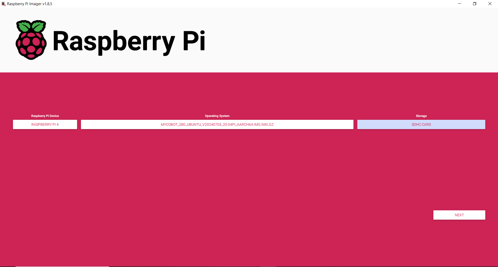

# setup_pi
If you are configuring many of the robot arms, you will need to setup our configurations. This includes broadcasting a wifi network automatically (setting up the raspberry pi in AP mode), installing docker, and pulling our docker image.

## Gather a Kit

Take an arm and ensure you have the full kit. This includes:
* G base
* clamp for G base
* power supply
* adaptor for power supply (US to UK)
* hdmi to mini hdmi cable
* lego connectors for g base
* usb wireless keyboard/mouse
* printed paper with grid markings for robot arm (this is in this repo [here](https://github.com/VModugno/MycobotProps))

## Flash the SD Card

Before you assemble the robot, it's helpful to take out the SD card and flash it with the [Ubuntu 20.04 image](https://www.elephantrobotics.com/en/downloads/) from elephant robotics. This is because it's a pain to take out once assembled. To get it out, jiggle it from side to side with your thumb nail as you move it out.

The reason we use Ubuntu 20.04, instead of the default 18.04, is because there were intermittentent network issues with ROS2 on the old Ubuntu that don't show up on the newer one.

We use Raspberry Pi Imager to flash it, selecting Raspberry Pi 4, selecting the zipped .img file that you've downloaded, selecting the microsd card, and then when asking if you want to change OS customizations settings don't do and select "No" (these come from elephant robotics).



## Assemble the Robot
Assemble the robot togeth
er. Start with the grid paper on the bottom. Put the mounting plate for the camera on top. Put the G base on top, aligning to markings on grid paper. Ensure that when unpowered, all the robot joints rotate smoothly with not undue effort.

From here, plug in the robot and power it on. You should see it boot on your monitor.

## Setup the Software on the Pi

You will probably want to change the resolution of the raspberry pi 4. To do this go to the search bar in the top left and search for `display` and then change the resolution to 1920x1080p.

Then you will want to disconnect the current wifi by going to the top right wifi symbol, clicking it, then selecting disconnect. Then find the wifi network for the lab and connect to that for internet. Refresh the system time zone as well.

Git clone this repo, and run it with sudo. It takes the name of the wifi network, which we name after the robot number, and the password. Ask someone for the password we use. We don't need to use sudo as the Pi is configured to run sudo commands w/o a password. And if it wasn't it would probably prompt us. We use the `$USER` variable so running with `sudo` will probably break it.
```
cd ~
git clone https://github.com/MZandtheRaspberryPi/kinematics_workshop.git
cd kinematics_workshop/setup_pi
bash setup_pi_2004.sh mycobot_23 my_wifi_pass
```

If you get an error like The certificate is not trusted...make sure that the system time is synced and date and time is correct, and try `sudo apt-get install --reinstall ca-certificates && sudo update-ca-certificates`.

# testing
After we run the setup script, it should restart the pi to apply some of the changes (specifically user group rules). Then ensure you can ssh into the robot with the `er` user. If this fails, use sudo to reset the password of the `er` user, or check `/var/log/auth.log` for another failure. Then the below and the robot should move.

```
docker run --rm -it --network host --device /dev/ttyAMA0 -v /home/er/kinematics_workshop:/home/developer/ros_ws/src/kinematics_workshop -v /dev/shm:/dev/shm mzandtheraspberrypi/ros_sim:2024-10-24
sudo apt-get remove -y python3-matplotlib
cd ros_ws
colcon build --symlink-install
source install/setup.bash
ros2 run ros_cobot_controller cobot_controller
```


### If the image hasn't yet been built on the cobot:
Compress the entire folder so we can copy it over to the robot and build the docker image there...

```
tar -czf /home/$USER/kinematics_workshop.tar.gz /home/$USER/kinematics_workshop
```

Connect to the robot's WIFI via your Ubuntu wifi interface (top right of screen). The WLAN should be named after the robot ID which is on a label on the base of the robot. Double check you are connected to the right robot--if you move a robot from somebody else's group that may surprise them and cause some damage to the robot or people. Check the robot's IP address, and SCP the file into the robot.

Connect to robot WiFi—“mycobot_23”, password: autonomy
Robot ip address: 10.42.0.1, user: er, password: elephant (or Elephant) —“ssh er@10.42.0.1”

enable on screen keyboard
```
gsettings set org.gnome.desktop.a11y.applications screen-keyboard-enabled true
```

Connect HDMI and mouse to robot, switch wifi to one with internet using virtual keyboard (to build docker image).

Copy the folder over....
```
scp /home/$USER/kinematics_workshop.tar.gz er@192.168.1.113:/home/er
```

SSH via new connection with ip address (from angry ip scanner for example, will depend on network you connect to). Has to be built for ARM and for AMD. don't try and build it on a raspberry pi 3b+. Use 4 or higher more. Or build it on a jetson and then transfer it.
```
ssh er@192.168.1.113
tar -xzf kinematics_workshop.tar.gz
docker build -f docker/Dockerfile -t ros_sim --progress plain .
docker save ros_sim:latest | gzip > ros_sim_latest.tar.gz
```

copy docker image back out
```
scp er@192.168.1.113:/home/er/ros_sim_latest.tar.gz .
```


### copy arm docker image to the cobot

This step only needs to be done once. Now that we have an image, we can do `docker pull`, but if updates need to be made this may be handy:

Ensure your computer is connected to the internet:

```
cd ~
docker pull --platform linux/arm64 mzandtheraspberrypi/ros_sim:2024-10-24
docker image save --platform linux/arm64 mzandtheraspberrypi/ros_sim:2024-10-24 | gzip > docker_ros_sim_arm.tar.gz
```

Now connect to the robot's WIFI.
```
scp /home/$USER/ros_sim.tar.gz er@10.42.0.1:/home/er
```
```
ssh er@10.42.0.1:/home/er
docker system prune -a
docker images # remove big images you see here
docker load --input docker_ros_sim_arm.tar.gz
rm docker_ros_sim_arm.tar.gz
```
